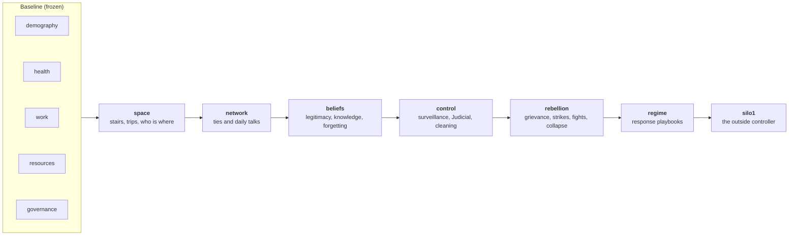

```text
  ░░░░░░░░░░░░░░░░░░░░░░░░░░░░░░░░░╔═╗░░░░░░  the outside
  ███████╗██╗██╗      ██████╗      ║▒║  Up Top      floors 1–48
  ██╔════╝██║██║     ██╔═══██╗     ║▒║
  ███████╗██║██║     ██║   ██║     ║▒║  Mids        floors 49–96
  ╚════██║██║██║     ██║   ██║     ║▒║
  ███████║██║███████╗╚██████╔╝     ║▒║  Down Deep   floors 97–144
  ╚══════╝╚═╝╚══════╝ ╚═════╝      ╚═╝
           18  ·  10,000 people  ·  300 years  ·  one Pact
```

# silosim

[](go.mod)
[](LICENSE)
[](go.mod)
[](docs/odd-spec.md)

**An agent-based simulation of Silo 18 from the TV series *Silo*, written in Go.** Ten thousand people live, work, pair up, win the birth lottery, grow old and die inside a 144-floor underground silo, for centuries, under the rules of the Pact. Around that closed society, the model adds what makes the show tick: a stairwell that keeps the floors apart, gossip that carries forbidden history, a regime that watches, arrests and sends people out to clean, and rebellions that start when grievance outweighs fear.

It is a research model, built for a university thesis. Every rule is written down first in an [ODD specification](docs/odd-spec.md), the standard protocol for describing agent-based models, and the code implements exactly that. Every number lives in a scenario file, with its source or the word "guess" next to it.

> **What it asks:** How often does a closed silo rebel, and what sets it off? Can a rebellion kill the silo? Which regime response keeps it alive afterwards: crackdown, reform, or wiping memory? And does the threat of an outside controller make it more stable or more fragile?

---

## Contents

- [What it simulates](#what-it-simulates)
- [How the engine works](#how-the-engine-works)
- [Status](#status)
- [Quick start](#quick-start)
- [The viewer](#the-viewer)
- [Output](#output)
- [Development](#development)
- [Documents](#documents)
- [References](#references)
- [Disclaimer](#disclaimer) · [License](#license)

---

## What it simulates

### The silo

Silo 18 is a vertical tube of 144 floors joined by one spiral stairwell, with no elevators. The model treats it as a line of floors where distance means time and time means isolation. It is split into three zones whose height mirrors social status:

| Zone | Floors | What happens there |
| --- | --- | --- |
| **Up Top** | 1–48 | the cafeteria and its screen of the outside, the Mayor, Judicial, IT, Medical, Education |
| **Mids** | 49–96 | the farms, Supply, markets, most homes |
| **Down Deep** | 97–144 | Mechanical: the generator that powers everything, the water plant, the air |

### Part 1, the baseline: a silo that works

The baseline (frozen at git tag `baseline-v1`) is a silo running normally under the Pact, with no dissent at all. It answers a narrow question first: *can the Pact's own rules keep a closed silo of 10,000 stable for 200 years?* Every later experiment is measured against it.

| Module | What it does | ODD § |
| --- | --- | --- |
| **demography** | Gompertz mortality; partnering and housing; the **birth lottery**: permits issued to hold the population at 10,000, implants removed for winners, one year to conceive | 6.1, 6.3, 6.4 |
| **health** | hunger, bad air, work injuries and illness, recovery that depends on how well Medical is staffed | 6.2 |
| **work** | children become **shadows** at 14 and learn a trade from a master, workers at 18; skill grows with experience; 11 departments with targets set by staffing needs | 6.5 |
| **resources** | a closed loop: the generator wears and fails, power drives water, air and food, and Supply makes the spare parts | 6.6, 6.7 |
| **governance** | the Mayor, appointed or elected | 6.8 |

The baseline is mechanical on purpose: no beliefs, no choices, no strategy. If it already held behaviour, nobody could tell later whether a rebellion came from the dissent rules or from a quirk in the base.

### Part 2: what keeps people in line, and what breaks it

Part 2 adds seven modules on top of the baseline, each switched on by listing it in the scenario file. Each module needs the ones before it:



| Module | What it adds | Built on |
| --- | --- | --- |
| **space** | every person is on a floor; multi-day trips on the stairwell; stair segments can break and cut the silo in two | the show's no-elevator design |
| **network** | partner, household, kin, master–shadow, coworker, neighbour and porter ties; each day some ties are used for a conversation, never across broken stairs | |
| **beliefs** | five facts people can know (the outside, the screen, the true history, other silos, the lottery), passed on in conversation, forgotten over time, kept alive by relics and the Flamekeepers, hidden by Vitamin D+; what you know sets your **legitimacy** of the regime | |
| **control** | the Pact as a rule table; the Head of IT; detection, arrests, trials, sentences, and **cleaning**, which is also a chance to escape | the show's Pact and Judicial |
| **rebellion** | grievance against fear of arrest, people coming out once enough of their ties have, strikes in critical departments, fights with Judicial, sabotage; the rules for a rebellion's start, end and **collapse** | Epstein (2002), Granovetter (1978), Lanchester (1916) |
| **regime** | a fixed *playbook* of responses (The Order, crackdown, reform, memory wipe, mixed), each started by a rebellion event and held for a set time; the regime does not learn | |
| **silo1** | Silo 1 watches through the Head of IT, gives orders after escapes, and can end the silo with the **Safeguard** | Season 3 |

A silo **collapses** when air or water stays below 20% for a month, when the Safeguard goes off, or when the population falls below the measured point of no return of 4,900 people.

The answers are **conditional and comparative**. Agents follow rules, not human judgement, so the model shows what follows from its assumptions ("if dissent works like Epstein's rule, reform keeps the silo alive more often than crackdown"), not what real people would do. Claims compare scenarios run on the same seeds.

---

## How the engine works

### One tick is one day

A run is a loop over days. Each day runs the same fixed sequence of steps, silo-wide systems first and then people, and the order is part of the model:

| When | Steps |
| --- | --- |
| **every day** | generator → life support → food → rations → work → health → deaths → reproduction → life stages → partnering → *network → beliefs → control → Silo 1 → rebellion → regime* → logging |
| **every 30 days** | lottery → housing → staffing |
| **every 365 days** | yearly snapshot → governance (the Mayor) |
| **every day, last** | *location*: where everyone is tomorrow |

Steps in *italics* belong to part-2 modules and run only when the module is on. People are visited in a new random order each day, and changes take effect at once: someone who dies in step 7 does not reproduce in step 8.

### Modules register steps; one file holds the order

A module doesn't run as one block. It registers **steps**, each at a numbered **phase** (100 × its ODD step number), and the engine runs every step in phase order. The order and frequency of every phase are kept in one file, [`internal/engine/schedule.go`](internal/engine/schedule.go). Phase numbers are spaced so that a part-2 step fits between two baseline steps (phase 750 sits between deaths and reproduction) without renumbering anything.

```go
type Module interface {
    Name() string
    Requires() []string                                   // e.g. beliefs requires network
    Init(w *world.World, cfg *config.Scenario, r *rng.Stream) error
    Steps() []Step                                        // {Phase, Run}
}
```

Modules share state only through `world.World`. A part-2 module keeps its per-person state in its own slices indexed by person ID, behind a pointer that is `nil` when the module is off, so a module that is off costs nothing and changes nothing.

Actions that take days (a prison sentence, a dosing period, the Safeguard's delay, scripted events such as a cleaning failure) go on the **agenda**: a min-heap keyed by day, phase and insertion order, so ties are deterministic.

### Deterministic by construction

- **Same scenario + same seed → byte-identical output.**
- **One random stream per module** (PCG, `math/rand/v2`). Switching on a new module never shifts the random draws of another, so two scenarios share their random numbers everywhere they don't differ (*common random numbers*), and differences between them come from the factor being tested, not from noise.
- **Keyed draws** for numbers several modules must agree on without storing them, such as whether two people talk today: a hash of the seed, the day and the pair.
- No global `math/rand`, no clock, no ranging over Go maps, no goroutines inside a run. Parallelism comes only from running many seeds at once.

### Guarded against silent changes

A broken simulation still produces plausible numbers, so the code is guarded on four levels:

| Guard | What it catches |
| --- | --- |
| **Unit and statistical tests** | each rule on a tiny hand-built world; expected rates checked over thousands of trials |
| **Invariants** | conservation and range checks (ODD §8), run every tick in tests |
| **Golden test** | a SHA-256 of a short run's output; any change to behaviour changes the hash |
| **Frozen baseline** | with every part-2 module off, the output is byte-identical to `baseline-v1` |

### Numbers come from config

Module code contains no numeric constants except 0, 1 and unit conversions. Every rate, age, share and threshold is a field in [`scenarios/baseline.yaml`](scenarios/baseline.yaml), commented with its ODD section and its basis. Other scenarios `extends:` it and override only what they change. Loading is strict: unknown keys, missing keys and out-of-range values all fail, and every problem is reported at once.

---

## Status

| Part | State |
| --- | --- |
| **Part 1: baseline** | done, frozen at tag `baseline-v1` (milestones 0–6 in [`docs/tasks.md`](docs/tasks.md)) |
| **Part 2: modules** | space, network, beliefs, control, rebellion, regime, Silo 1 built (milestones 7–14 in [`docs/tasks-part2.md`](docs/tasks-part2.md)) |
| **Results viewer** | done (milestone 16) |
| **Experiments** | written down in [`docs/experiments.md`](docs/experiments.md); runs pending (milestone 15) |

Baseline calibration on 100 seeds × (50 warm-up + 200 measured) years ([`docs/calibration-log.md`](docs/calibration-log.md), 2026-10-30):

| Pattern (ODD §8) | Target | Seeds passing |
| --- | --- | ---: |
| Stable population | 9,000–11,000 every day | 100 / 100 |
| Plausible ages | median age 30–40 every year | 100 / 100 |
| No demographic shocks | 5-year births change < 30% | 100 / 100 |
| Balanced resources | rationing < 5% of days | 100 / 100 |
| Rare crises | 1–6 generator failures per century | 96 / 100 |
| Staffed departments | never below 50% of target for > 1 year | 100 / 100 |
| Persistent zones | Mechanical workers living Down Deep > 75% | 100 / 100 |

A pattern holds when at least 90 of 100 seeds pass. Part 2 is validated against five **canon patterns** taken from the show (ODD §1.2): rebellions are rare but happen (C1), visible failures trigger revolts (C2), revolts start Down Deep and use the generator (C3), crushed rebellions are forgotten (C4), and a rebellion can end a silo (C5).

---

## Quick start

Requires **Go 1.27** or newer. The only dependency outside the standard library is `gopkg.in/yaml.v3`.

```bash
git clone https://github.com/skrilexxx/silo-sim.git && cd silo-sim
make build                                                    # → bin/silosim

bin/silosim run    --scenario scenarios/canon.yaml --seed 42  # one silo, 50 + 300 years
bin/silosim run    --scenario scenarios/canon.yaml --dry-run  # print the resolved parameters
bin/silosim batch  --scenario scenarios/canon.yaml --seeds 1-30 --out runs/canon [--workers 8]
bin/silosim report --batch runs/canon                         # calibration targets and canon patterns
bin/silosim report --batch runs/canon --outcomes              # outcome metrics with 95% intervals
bin/silosim serve  --runs runs                                # the viewer on http://127.0.0.1:8080/
```

**Timing.** A baseline run (250 years) takes about a minute; a run with every part-2 module on takes several minutes. A batch runs one seed per CPU core.

### Scenarios

| File | What it is |
| --- | --- |
| [`baseline.yaml`](scenarios/baseline.yaml) | the complete parameter set; part-2 modules off |
| [`canon.yaml`](scenarios/canon.yaml) | every module on at the show's settings, the regime playing The Order |
| [`replay.yaml`](scenarios/replay.yaml) | canon with per-floor frames on, for the replay view |
| `strategy-*.yaml` | the regime responses compared in Q3: none, crackdown, reform, memory wipe, mixed |
| [`experiments/`](scenarios/experiments) | the experiments E1–E5 of [`docs/experiments.md`](docs/experiments.md) |
| [`part2-off.yaml`](scenarios/part2-off.yaml) | every part-2 section present, every module off; must equal the baseline |

---

## The viewer

`silosim serve` is a read-only web viewer, built into the binary: Go's standard HTTP server with the page embedded, and one vendored chart library ([uPlot](https://github.com/leeoniya/uPlot)). It only reads files under `runs/`, so a run with the viewer open is the same as a run without it.

| View | Shows |
| --- | --- |
| **Runs** | every batch and single run, newest first |
| **Dashboard** | one run's population, life support, health and hardship, dissent and legitimacy on one time axis, with rebellions shaded and events marked |
| **Replay** | the silo as a column of 144 floors coloured by population, health, legitimacy or rebels, with play and pause, broken stairs and a timeline |
| **Experiment** | batches side by side: Kaplan–Meier survival curves, rebellion rates and endings with 95% intervals, the same numbers `silosim report --outcomes` prints |

---

## Output

Each run writes `runs/<scenario>-<seed>/`:

| File | Content |
| --- | --- |
| `daily.csv` | population, births and deaths, food, power, water, air, health and hardship by zone; with part 2 on, adults active, joined and violent, workers on strike, zones held, broken stair segments |
| `yearly.csv` | age pyramid, department staffing, the Mayor; legitimacy and knowledge by zone |
| `events.jsonl` | generator failures and repairs, rationing, the Mayor and the Head of IT; with part 2, cleanings, unrest, rebellion starts and ends, sabotage, zones held, policy changes, collapse |
| `rebellions.jsonl` | one line per rebellion: start, trigger, zone, peak, duration, collective actions, deaths, arrests, damage, ending |
| `run.json` | the resolved scenario, seed, git commit, Go version, runtime and outcomes |
| `frames.csv.gz` | optional per-floor snapshots for the replay view |

Warm-up years are not written. The same seed always gives byte-identical files.

---

## Development

```bash
make check          # build, gofmt, vet, all tests including the golden test
make test           # go test ./...
make bench          # time one full baseline run
make update-golden  # only when behaviour changes on purpose; give the reason in the commit
```

The working rules (the spec decides behaviour, the baseline stays frozen, numbers come from config, determinism, one task at a time) are in [`CLAUDE.md`](CLAUDE.md). A change to model behaviour starts as a change to [`docs/odd-spec.md`](docs/odd-spec.md).

```text
cmd/silosim/            CLI: run, batch, report, serve
internal/engine/        tick loop, schedule.go (the step order), agenda, module registry
internal/world/         state: people, households, floors, departments, the silo
internal/modules/       one package per module (baseline and part 2)
internal/config/        scenario loading, extends, strict validation
internal/rng/           seeded streams, one per module; keyed draws
internal/invariants/    ODD §8 checks
internal/output/        the run files
internal/report/        calibration targets, canon patterns, outcome statistics
internal/serve/         the viewer
scenarios/              parameter sets
analysis/               batch and experiment scripts
```

---

## Documents

| Document | What it is |
| --- | --- |
| [`docs/odd-spec.md`](docs/odd-spec.md) | **the model**, described with the ODD protocol; the source of truth for behaviour |
| [`docs/architecture.md`](docs/architecture.md) | how the spec becomes code: engine, modules, randomness, testing |
| [`docs/lore-reference.md`](docs/lore-reference.md) | the show's mechanics behind the spec, each tagged certain, likely or guessed |
| [`docs/calibration-log.md`](docs/calibration-log.md) | every calibration run and the spec decisions it led to, in order |
| [`docs/experiments.md`](docs/experiments.md) | the experiments, written down before they run |
| [`docs/viewer.md`](docs/viewer.md) | the viewer's spec |
| [`docs/tasks.md`](docs/tasks.md), [`docs/tasks-part2.md`](docs/tasks-part2.md) | the build plans, with every decision dated |

---

## References

**Modelling**

- Grimm, V. et al. (2020). [The ODD protocol for describing agent-based and other simulation models: a second update](https://www.jasss.org/23/2/7/7.pdf). *Journal of Artificial Societies and Social Simulation* 23(2) 7. The structure of the spec.
- Epstein, J. M. (2002). [Modeling civil violence: an agent-based computational approach](https://www.pnas.org/doi/10.1073/pnas.092080199). *PNAS* 99(suppl. 3) 7243–7250. Grievance, legitimacy, risk aversion and the activation rule.
- Granovetter, M. (1978). Threshold models of collective behavior. *American Journal of Sociology* 83(6) 1420–1443. Joining once enough of one's ties have.
- Lanchester, F. W. (1916). *Aircraft in Warfare.* The square law for fights between rebels and Judicial.
- Gompertz, B. (1825). The law of adult mortality; the parameters here are tuned by hand, not taken from a life table.
- Kaplan, E. L. & Meier, P. (1958); Greenwood, M. (1926); Wilson, E. B. (1927). Survival curves and confidence intervals in `silosim report --outcomes`.

**Lore**

The silo's mechanics come from the Apple TV+ series only, through the Season 3 finale, and not from the books. [`docs/lore-reference.md`](docs/lore-reference.md) lists each mechanic with what the show establishes, how sure that is, and where it was checked. Where the show is silent, the gap becomes a parameter marked as a guess rather than being filled in.

---

## Disclaimer

This is an unofficial, non-commercial research project. It is not affiliated with, endorsed by, or connected to Apple TV+ or Hugh Howey, author of the *Wool* novels on which the series *Silo* is based. *Silo* and its names are the property of their owners. No characters, scripts or media from the series are included: the show's setting is used only as the subject of a simulation model.

## License

[MIT](LICENSE) © 2026 Adam Kopřiva. The vendored uPlot library in `internal/serve/static/vendor/uplot/` is MIT-licensed by its authors ([its licence](internal/serve/static/vendor/uplot/LICENSE)).
